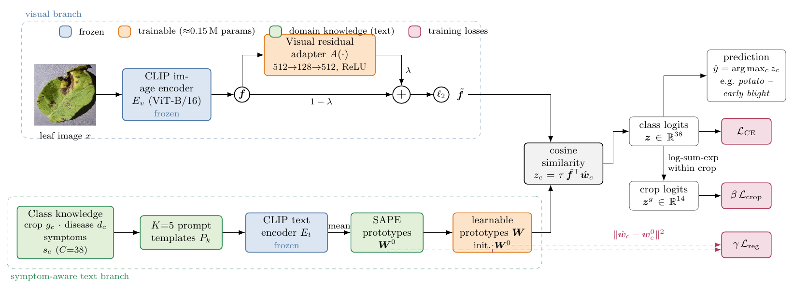
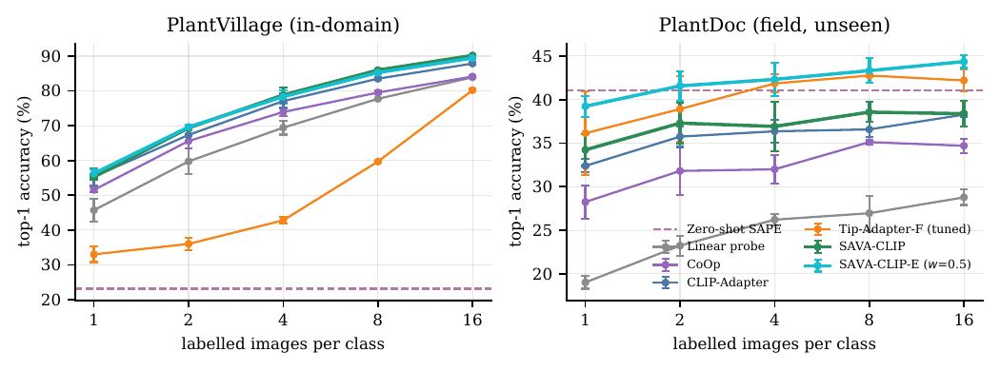
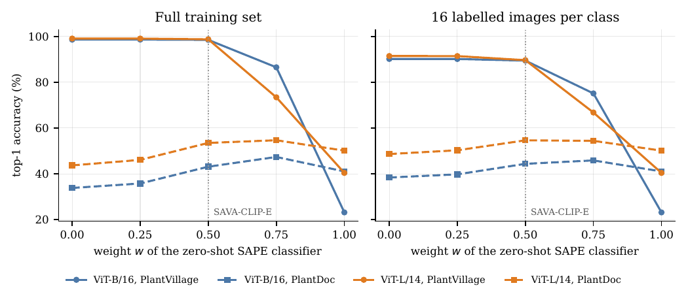

# SAVA-CLIP: Symptom-Aware Vision–Language Adaptation for Leaf Disease Recognition

Code, symptom descriptions, data splits and raw results for the paper

> **Symptom-aware vision–language adaptation for few-shot leaf disease recognition under laboratory-to-field domain shift**
> G. Nagaraju, Department of CSE (AIML, IoT & R&AI), VNR Vignana Jyothi Institute of Engineering and Technology, Hyderabad, India.
> *Manuscript under review.*

Deep networks trained on laboratory photographs of leaves are almost perfect on laboratory images but fail on field images, and every new disease needs new labelled data. This repository studies how a frozen **CLIP** vision–language model can be adapted to leaf disease recognition with very few labelled images while staying robust to field conditions.



## Method in brief

- **SAPE – symptom-aware prompt ensembles.** Each class is described by its *visible* symptoms (e.g. *"dark brown circular spots with concentric target-like rings and yellow surroundings"*), combined with crop and disease names through 5 templates. This alone is a training-free classifier.
- **SAVA-CLIP.** A small head on a frozen CLIP encoder: a residual visual adapter plus learnable class prototypes that are initialised from SAPE and anchored to it by a consistency loss, with a crop-aware hierarchical loss. Only **0.15 M** (ViT-B/16) or **0.32 M** (ViT-L/14) parameters are trained.
- **SAVA-CLIP-E.** A parameter-free 50/50 ensemble of SAVA-CLIP and the training-free SAPE classifier, which keeps laboratory accuracy and gives the best field accuracy.

## Main results

Models are trained on **PlantVillage** (38 classes, 54,305 laboratory images) and tested, without any re-training, on **PlantDoc** field images (2,578 images, 28 classes).

**Full training set** (top-1 accuracy, %):

| Method | Trainable params | PlantVillage | PlantDoc (field) |
|---|---|---|---|
| ResNet-50, fine-tuned | 23.59 M | 99.91 | 18.93 |
| ViT-B/16, fine-tuned | 85.83 M | 99.84 | 19.86 |
| Qwen2-VL-2B, zero-shot (generative VLM) | 0 | 13.18* | 34.13 |
| CLIP ViT-B/16, zero-shot SAPE | 0 | 23.14 | 41.04 |
| CLIP ViT-B/16 + CLIP-Adapter | 0.13 M | 98.46 | 38.01 |
| CLIP ViT-B/16 + **SAVA-CLIP** | 0.15 M | 98.61 | 33.83 |
| CLIP ViT-B/16 + **SAVA-CLIP-E** | 0.15 M | 98.50 | **43.10** |
| CLIP ViT-L/14, zero-shot SAPE | 0 | 40.39 | 50.12 |
| CLIP ViT-L/14 + **SAVA-CLIP** | 0.32 M | **99.08** | 43.68 |
| CLIP ViT-L/14 + **SAVA-CLIP-E** | 0.32 M | 98.75 | **53.49** |

\* on a stratified subset of 941 PlantVillage test images.

**Few-shot** (16 labelled images per class, mean of 3 seeds): SAVA-CLIP reaches **90.18 %** (ViT-B/16) and **91.44 %** (ViT-L/14) on PlantVillage.





All numbers in the paper are in [`results/`](results/): `results_main.json` (first experiment run) and `results_extension.json` (second run: tuned Tip-Adapter-F, CoOp, ViT-L/14, ensembles, sensitivity analysis, McNemar tests).

## Repository structure

```
code/
  classes.py               38 classes, symptom descriptions, prompt templates, PlantDoc mapping
  data.py                  dataset indexing, 80/10/10 stratified split (seed 42), transforms
  sava.py                  CLIP wrapper, SAVA-CLIP, CLIP-Adapter, Tip-Adapter-F, linear probe
  run_all.py               main experiments (zero-shot, few-shot, ablation, full data)
  train_cnn.py             ResNet-50 / ViT-B/16 fine-tuning baselines
  generative_vlm.py        Qwen2-VL zero-shot baseline
  extend.py                extension experiments (tuned Tip-Adapter-F, CoOp, ViT-L/14, ensembles,
                           sensitivity, McNemar)
  write_tex.py, make_figures.py, make_journal_figures.py, make_data_figs.py   tables and figures
notebooks/
  01_main_experiments_kaggle.ipynb        runs run_all.py, train_cnn.py, generative_vlm.py
  02_extension_experiments_kaggle.ipynb   runs extend.py
data/
  symptom_descriptions.csv                the 38 symptom descriptions
  plantdoc_to_plantvillage.csv            class mapping used for the field test
results/                                  raw results of both runs
assets/                                   figures for this README
```

## Reproducing the experiments

### Option A – Kaggle (free GPU, what we used)
1. Upload the `code/` folder (zipped) as a private Kaggle dataset.
2. Import a notebook from `notebooks/`, attach the dataset, set **Accelerator = GPU T4 x2** and **Internet = On**.
3. Run **Save & Run All (Commit)**. Run 1 takes about 4 h, run 2 about 2.5 h on 2× T4. Results appear in the notebook's Output tab.

### Option B – your own GPU
```bash
pip install -r requirements.txt
git clone https://github.com/spMohanty/PlantVillage-Dataset
git clone https://github.com/pratikkayal/PlantDoc-Dataset
cd code
PV=../PlantVillage-Dataset/raw/color
PD=../PlantDoc-Dataset

python run_all.py  --pv_root $PV --pd_root $PD --out results
python train_cnn.py --arch resnet50 --pv_root $PV --pd_root $PD --out results
python train_cnn.py --arch vit_b_16 --pv_root $PV --pd_root $PD --out results
python generative_vlm.py --pv_root $PV --pd_root $PD --out results --n_pv 950
python extend.py   --pv_root $PV --pd_root $PD --out results/ext
```

Hyper-parameters (fixed before the experiments): λ = 0.2, β = 0.5, γ = 5, K = 5 templates, AdamW lr 1e-3, 1,000 steps (few-shot) or 20 epochs (full data), ensemble weight w = 0.5.

## Datasets

This repository does **not** redistribute images. Please obtain them from the original sources and cite them:
- PlantVillage – Hughes & Salathé (2015), https://github.com/spMohanty/PlantVillage-Dataset
- PlantDoc – Singh et al. (2020), https://github.com/pratikkayal/PlantDoc-Dataset

## Citation

If you use this code or the symptom descriptions, please cite the paper (citation will be updated after publication):

```bibtex
@article{nagaraju2026savaclip,
  author  = {Nagaraju, G.},
  title   = {Symptom-aware vision--language adaptation for few-shot leaf disease recognition under laboratory-to-field domain shift},
  journal = {Manuscript under review},
  year    = {2026}
}
```

## Licence

Code and symptom descriptions are released under the MIT Licence (see [`LICENSE`](LICENSE)). The datasets keep their original licences.

## Contact

G. Nagaraju – nagaraju.gujjeti@gmail.com
